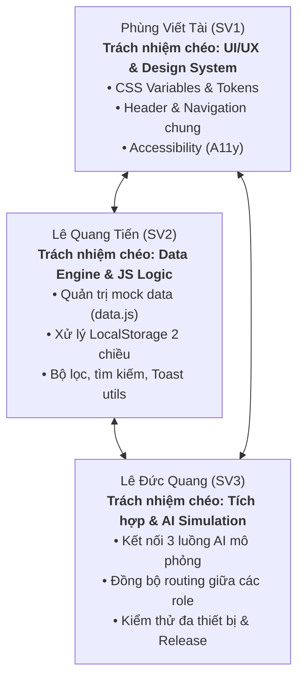

# BẢNG PHÂN CÔNG CÔNG VIỆC NHÓM (TEAM ASSIGNMENT)
**Học phần:** PHÁT TRIỂN ỨNG DỤNG WEB CƠ BẢN – CSE122  
**Đề tài (BTL-36):** SmartBuilding – Bảng điều khiển năng lượng & Điều phối tiết kiệm  
**Nhóm thực hiện:** Nhóm 18  

---

## 1. Thông tin thành viên & Vai trò chính

| STT | Họ và tên | MSSV | Vai trò chính trong dự án | Các màn hình phụ trách chính |
| :---: | :--- | :---: | :--- | :--- |
| **1** | **Phùng Viết Tài** *(Trưởng nhóm)* | SV1 | **Người sử dụng tòa nhà (Occupant)** & Phụ trách Giao diện Portal | 1. `html/occupant-dashboard.html` 2. `html/occupant-energy-challenges.html` 3. `html/occupant-comfort-feedback.html` 4. `html/occupant-energy-history.html` 5. `html/occupant-rewards.html` 6. Đồng phụ trách: `index.html` |
| **2** | **Lê Quang Tiến** | SV2 | **Nhân viên vận hành (Operator)** | 1. `html/operator-energy-monitor.html` 2. `html/operator-alert-center.html` 3. `html/operator-saving-actions.html` 4. Đồng phụ trách: `html/login.html` |
| **3** | **Lê Đức Quang** | SV3 | **Quản lý cơ sở (Facility Manager)** & **Quản trị viên (Admin)** | 1. `html/manager-energy-kpis.html` 2. `html/manager-zone-comparison.html` 3. `html/manager-monthly-report.html` 4. `html/admin-zone-management.html` 5. `html/admin-sensor-management.html` 6. `html/admin-user-management.html` 7. Đồng phụ trách: `html/404.html` |

---

## 2. Trách nhiệm chéo bắt buộc (Cross-cutting Responsibilities)

Quy định môn học yêu cầu tránh việc tạo ra ba "website con" rời rạc. Mỗi thành viên đảm nhận một mảng kỹ thuật xuyên suốt:

### Chi tiết phân công mảng kỹ thuật:
1. **Phùng Viết Tài (SV1) - Phụ trách Hệ thống thiết kế & Trải nghiệm (UI/UX & Design System):**
   - Thiết lập và quản lý bộ CSS Tokens đồng nhất (`css/style.css`, `css/responsive.css`): bảng màu Emerald/Slate, typography Outfit/Inter, hiệu ứng bóng mờ (box-shadow, glassmorphism), border-radius.
   - Xây dựng thanh điều hướng chung (Navbar/Sidebar) đảm bảo chuyển đổi mượt mà giữa các vai trò.
   - Đảm bảo chuẩn tiếp cận Web A11y (độ tương phản màu sắc, thuộc tính ARIA, hỗ trợ phím Tab).

2. **Lê Quang Tiến (SV2) - Phụ trách Tầng dữ liệu & Logic JavaScript dùng chung (Data Engine & JavaScript):**
   - Thiết kế cấu trúc các thực thể dữ liệu gốc trong `javascript/data.js` (`zones`, `sensors`, `readings`, `alerts`, `actions`, `challenges`, `feedbacks`).
   - Viết các hàm tiện ích dùng chung trong `javascript/main.js`: hàm đọc/ghi `localStorage`, hàm tạo thông báo nổi (Toast Notification), hàm mở/đóng Modal Popup, hàm định dạng số điện và tiền tệ.
   - Đảm bảo toàn bộ thao tác CRUD trên mọi màn hình phản ánh đồng bộ vào `localStorage`.

3. **Lê Đức Quang (SV3) - Phụ trách Kiến trúc AI mô phỏng & Đảm bảo chất lượng (AI Architecture & QA):**
   - Hiện thực chu trình tương tác cho 3 tính năng AI: *Nhập liệu ➔ Đang xử lý ➔ Kết quả & Lý do ➔ Quyết định (Chấp nhận / Sửa / Bác bỏ)*.
   - Xây dựng kịch bản dự phòng khi AI lỗi (Fallback State).
   - Kiểm thử chéo toàn bộ ứng dụng trên nhiều kích thước màn hình (Desktop, Tablet, Mobile) và kiểm tra sạch lỗi Console F12 trước khi bàn giao.

---

## 3. Ma trận trách nhiệm (RACI Matrix)

*Quy ước: **R** (Responsible - Người thực hiện), **A** (Accountable - Người chịu trách nhiệm chính), **C** (Consulted - Người được tham vấn ý kiến), **I** (Informed - Người nhận thông tin).*

| Hạng mục công việc | Phùng Viết Tài (SV1) | Lê Quang Tiến (SV2) | Lê Đức Quang (SV3) |
| :--- | :---: | :---: | :---: |
| Lập kế hoạch Trello & Tài liệu đề tài | **A / R** | **C** | **C** |
| Xây dựng Design System (CSS tokens, Navbar) | **A / R** | **C** | **I** |
| Khởi tạo Mô hình dữ liệu & LocalStorage | **C** | **A / R** | **C** |
| Màn hình vai trò Người dùng tòa nhà (SV1) | **A / R** | **I (Review PR)** | **I** |
| Màn hình vai trò Nhân viên vận hành (SV2) | **I (Review PR)** | **A / R** | **I** |
| Màn hình vai trò Quản lý & Quản trị viên (SV3) | **I** | **I (Review PR)** | **A / R** |
| Tính năng AI-1: Energy Anomaly Detector | **I** | **R** | **A** |
| Tính năng AI-2: Saving Recommendation | **R** | **A** | **C** |
| Tính năng AI-3: What-If Simulator | **C** | **C** | **A / R** |
| Kiểm thử Responsive & Khả năng tiếp cận | **A / R** | **R** | **R** |
| Quay video OBS minh chứng từng màn hình | **R (màn hình SV1)** | **R (màn hình SV2)** | **R (màn hình SV3)** |
| Tổng hợp báo cáo sử dụng AI & Hoàn tất BTL | **R** | **R** | **A / R** |

---

## 4. Kế hoạch phối hợp & Review Code chéo (Peer Review)

- **Quy tắc duyệt Pull Request (PR):**
  - Mọi PR từ nhánh `feature/*` vào `dev` bắt buộc phải có ít nhất **1 thành viên khác chấp thuận (Approve)** sau khi kiểm tra code không xung đột và tuân thủ chuẩn responsive.
  - Cặp đôi review chéo:
    - SV1 tạo PR ➔ SV2 kiểm tra & review.
    - SV2 tạo PR ➔ SV3 kiểm tra & review.
    - SV3 tạo PR ➔ SV1 kiểm tra & review.
- **Cam kết tiến độ:** Họp nhóm nhanh (Daily Standup) 15 phút mỗi tối qua Discord/Google Meet để đồng bộ tiến độ Trello và giải quyết vướng mắc kỹ thuật.
